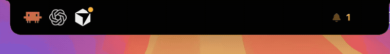
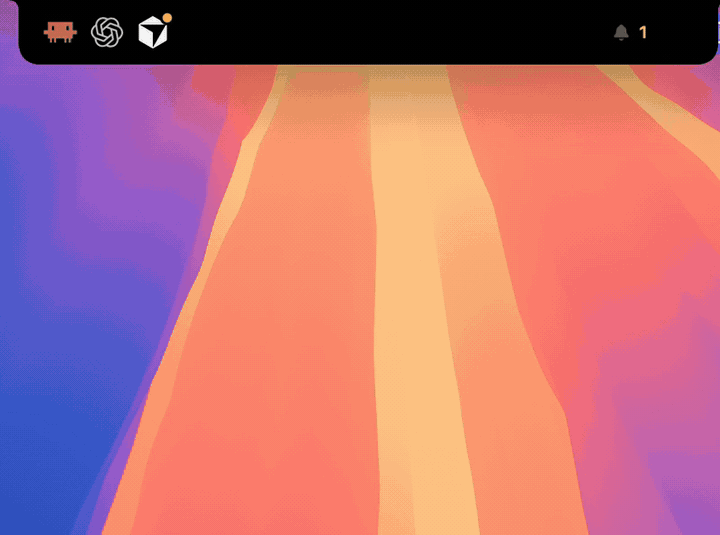

<p align="center">
  
</p>

<h1 align="center">NotchBot</h1>

<p align="center">
  <strong>Your coding agents, living in the notch.</strong><br>
  Claude Code, Codex, and Cursor. Who’s working, who’s waiting, and how much of the plan is left.
</p>

<p align="center">
  <a href="https://github.com/scorp84/NotchBot/stargazers"></a>
  
  
  <a href="LICENSE"></a>
</p>

<p align="center">
  <a href="https://www.buymeacoffee.com/scorp84"></a>
</p>

You start three agents, switch back to your own work, and find out twenty minutes later that one of them has been sitting on an approval the whole time.

NotchBot watches the session files those tools already write, and puts the answer where your eyes already are.

<p align="center">
  
</p>

## What you get

**While they work.** A mark for each agent on the left wing of the notch. Claude hops, Codex turns, Cursor tilts, and a light sweeps the bottom edge for as long as something is busy. The right wing shows a live wave and, when more than one agent is going, the count.

**When one needs you.** An amber bell, a pulsing ring, and a banner that stays up. This is the whole point. Permission prompts and questions stop being something you discover later.

**When one finishes.** The notch drops a small banner — *Claude finished · 4m 12s* — and plays a soft sound. Click it to jump straight back into that app, or the terminal running it.

**How much plan is left.** Hover and the meters sit above the sessions. Claude shows the weekly window and the 5-hour window. Codex shows its window, the plan name, and any credit balance the app already recorded. The bar keeps the agent’s color, turns amber past 75%, and red past 90%. Once a limit is that hot and nothing more urgent is going on, the percentage shows in the notch itself.

**When you hover.** Every session under those meters: title, project, the live step (`$ swift test`, `Editing Login.swift`, `Thinking…`), elapsed time, Codex sub-agents, and today’s finished count. Click a row to focus that session.

The menu-bar ✦ icon turns sounds, the finish banner, and launch-at-login on or off.

## Install

macOS 14 or later, with Xcode or the Swift command-line tools. A notched MacBook is the home it was built for. On a display without a notch it sits as a pill in the menu bar.

```bash
git clone https://github.com/scorp84/NotchBot.git
cd NotchBot
bash build-app.sh
open dist/NotchBot.app
```

The build is ad-hoc signed, so the first launch needs a nudge from Gatekeeper. Right-click `dist/NotchBot.app`, choose **Open**, then **Open** again.

```bash
xattr -dr com.apple.quarantine dist/NotchBot.app
```

## What it watches

| Agent | Where the signal comes from | Setup |
|---|---|---|
| Claude Code, CLI and the desktop Code tab | `~/.claude/sessions` for live busy / idle, plus the transcript tail for the current step | None |
| Claude approval prompts | A Notification hook in `~/.claude/settings.json` | **Show Claude approvals** in the tray or the menu |
| Codex, desktop and CLI | `~/.codex/sessions` rollout files and `session_index.jsonl` | None |
| Cursor, the IDE and cursor-agent | Cursor hooks → `~/.notchbot/notchbot-hook` → `~/.notchbot/events.jsonl` | **Connect Cursor** once |

Connecting only adds NotchBot’s own entries. Your existing hooks and settings stay, and the file it edits gets a `.notchbot-backup` beside it.

The meters are read from the snapshots Claude and Codex already keep locally (`~/.claude.json`, Codex `rate_limits` events). Cursor has no local usage file, so it doesn’t get a meter. Nothing here calls their APIs.

## Private by default

Sessions, prompts, and commands stay on your Mac. NotchBot has no account, no telemetry, and no network call. The only things it writes are the opt-in hook entries above, and a small event log in `~/.notchbot/` that it rotates at 5 MB.

## Hacking on it

```bash
swift build -c release
.build/release/NotchBot --dump          # print every session the monitors can see
open dist/NotchBot.app --args --show    # open the tray
open dist/NotchBot.app --args --peek    # play the finish banner
```

The notch silhouette follows the same language as [NotchKit](https://github.com/aishwaryaashok14/notch-kit) (MIT).

## License

[MIT](LICENSE) © 2026 [Florian Kall](https://github.com/scorp84)

<p align="center">
  If NotchBot catches one forgotten approval, star the repo.<br>
  If it catches ten, <a href="https://www.buymeacoffee.com/scorp84">buy me a coffee</a>.
</p>

<p align="center">
  <a href="https://www.buymeacoffee.com/scorp84"></a>
</p>
